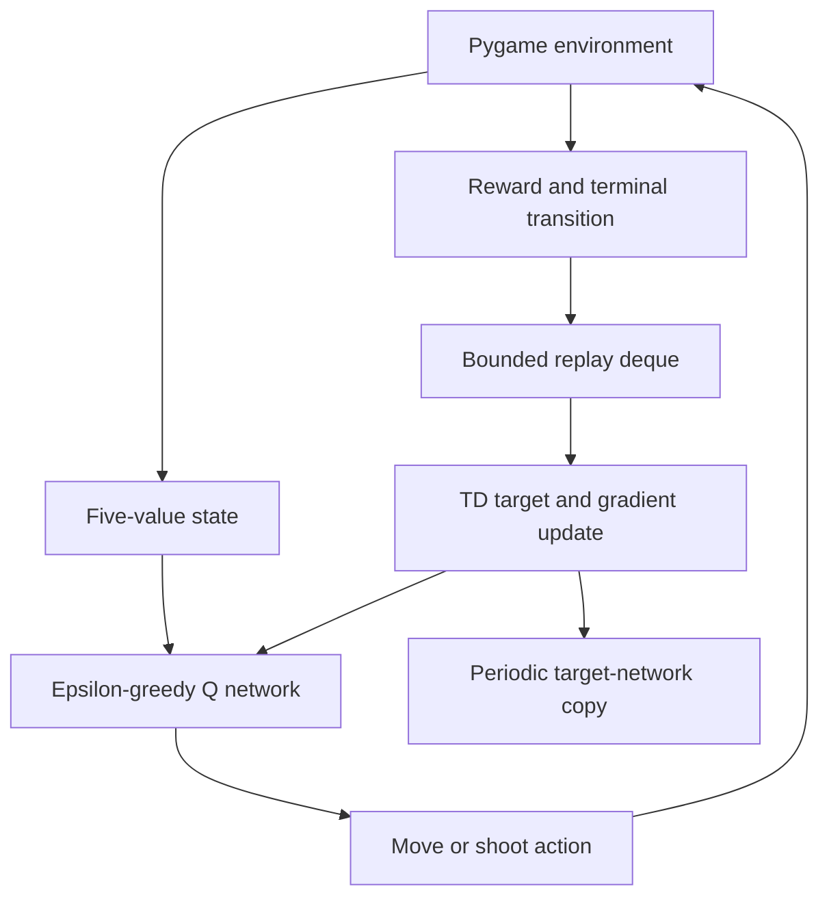

# Zombie Hunter DQN architecture

Maintenance review: **11 November 2026**. Inspected base commit: `b8f832daf53df0bb57a2356e798a3a1d13ac3ed4`.

Interactive educational Pygame simulation with an online DQN learner. Current code is a local experiment, not a validated autonomous policy or scalable service.

## Current implementation

| Source boundary | Responsibility and implementation status |
| --- | --- |
| `ai.py: DQN` | Five inputs, three 256-unit hidden layers and five Q outputs. |
| `ai.py: ReplayBuffer` | Deque bounded to 10,000 experiences, sampled in batches of 64. |
| `ai.py: AISaviorRL` | Action selection, damage, state encoding, training and episode reset. |
| `ai.py: main loop` | Pygame events, world progression, transition recording and rendering. |

## Changes in this maintenance pass

Death previously reset health and replaced the environment before the replay observation and reward were recorded. Terminal records now capture zero-health next state and the death penalty before reset. Action selection disables gradient recording; absence of an audio device no longer aborts startup. Existing game constants and academic learning behavior remain otherwise recognizable.

## Verification and repeatable checks

`python -m unittest discover -s tests -v` executes the actual transition block against a deterministic fake environment and verifies terminal observation, death penalty and reset order. It does not import Pygame or run training. GUI rendering and learning convergence require a configured Pygame/PyTorch session.

Record the exact commit and hosted workflow result when reviewing a change. Passing a focused regression does not establish end-to-end reliability or measured capacity.

## Scale and ownership decisions

These are explicit **future design steps**, not implemented infrastructure or measured capacity claims.

| Pressure or boundary | Decision and next evidence |
| --- | --- |
| Simulation | Extract a headless environment with explicit reset/step/seed before independent rollout workers; keep deterministic transition tests. |
| Collision work | Profile large zombie levels and replace pairwise overlap checks with a spatial grid only when measurements justify it. |
| Experiments | Record seeds, episode return, survival and policy checkpoints; compare held-out seeds and a baseline policy before changing model capacity. |

Keep one owner for each data contract, centralize paths/configuration, and review dependency changes with the smallest relevant regression suite. Separate computed results from static fixtures; version inputs with artifacts. Before release, reproduce setup from a clean checkout and check both failure paths and resource cleanup.

## Operational limits and recovery

All training and rendering share one loop, episode state is not checkpointed, collision separation is quadratic in zombie count, and rewards are hand-designed. The five-value observation omits much of the world state. The maintenance check does not establish a successful learned policy.

Keep a known-good commit and backup mutable experiment artifacts before running migrations or training. On failure, preserve the error and input/configuration version; restore the prior artifact set or checkout the known-good code before retrying. No cloud deployment, paid service provisioning, data migration or production-scale load test was performed by this maintenance pass.
